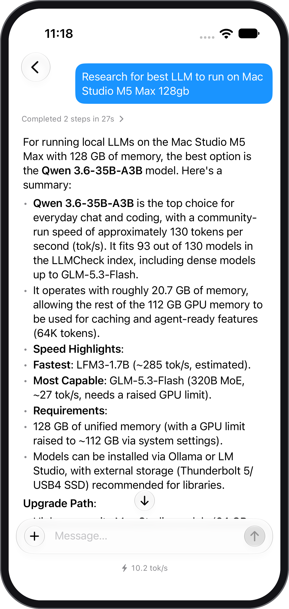
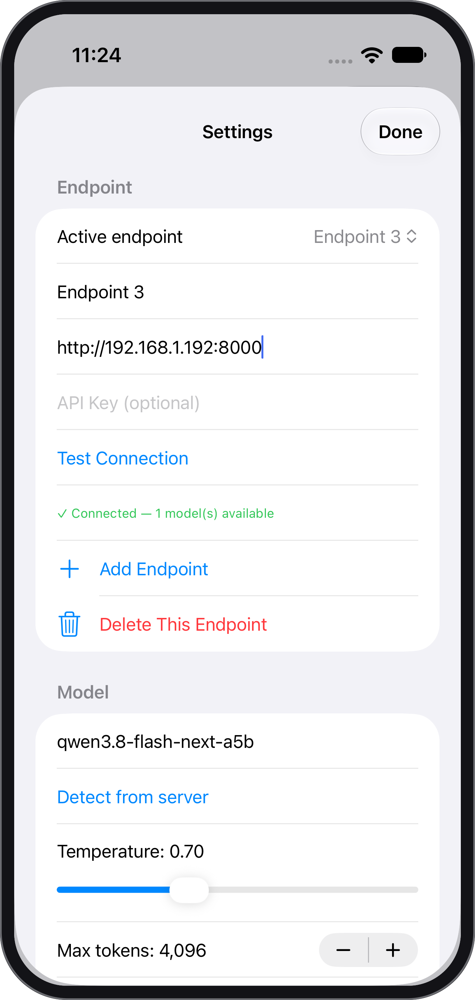
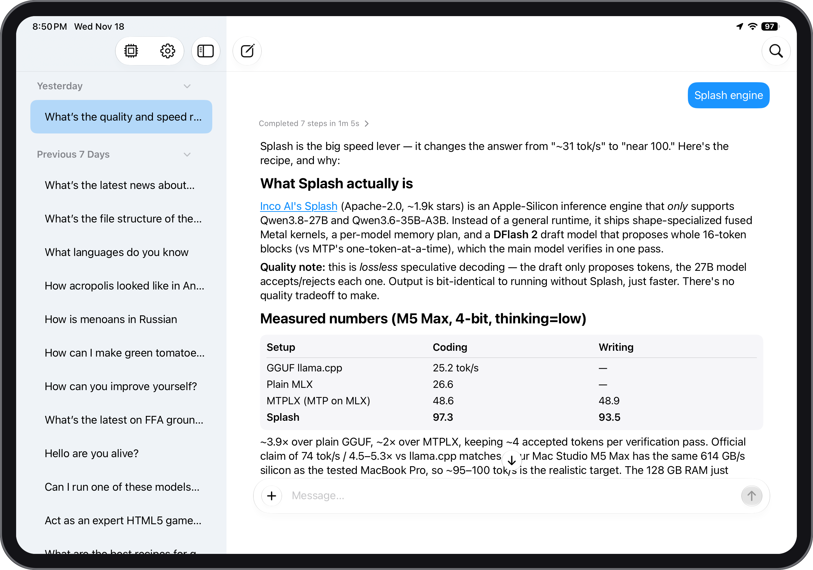

# Sparkle

SwiftUI iPad/iOS client for a local LLM served any OpenAI-compatible server over the LAN.
Phase one: chat harness with streaming, conversation history, tool calling, and settings.

## Screenshots

<p align="center">
  
  
</p>
<p align="center">
  
</p>

## Requirements
- Xcode 27 (built with Xcode 27.1), iOS 26+ deployment target
- An OpenAI-compatible server on the Spark (vLLM, llama.cpp `llama-server`, Ollama's OpenAI endpoint, LM Studio, …)

## Build & run
```bash
xcodegen generate          # creates DGXChat.xcodeproj (already generated)
open DGXChat.xcodeproj     # run from Xcode, or:
xcodebuild -project DGXChat.xcodeproj -scheme DGXChat \
  -destination 'generic/platform=iOS Simulator' build CODE_SIGNING_ALLOWED=NO
```
For a real device, set your signing team in Xcode → target → Signing.

## Connecting to the Spark
1. Start a server on the Spark, e.g. vLLM:
   `vllm serve Qwen/Qwen3-32B --host 0.0.0.0 --port 8000`
   or llama.cpp: `llama-server -m model.gguf --host 0.0.0.0 --port 8080`
2. In the app: **Settings ⚙ → Base URL** = `http://<spark-ip>:8000`, then **Test Connection**.
3. Pick the model from the toolbar picker.

Notes:
- Cleartext HTTP is enabled via ATS (`NSAllowsArbitraryLoads`) for LAN use.
- The app accepts both `http://host:port` and `http://host:port/v1` forms.
- Simulator testing: point Base URL at `http://127.0.0.1:<port>` if the server runs on the Mac.

## Features (phase one)
- **Streaming chat** — SSE deltas rendered live, with a stop button
- **Conversation history** — SwiftData persistence, sidebar list, auto-titles
- **Markdown rendering** — headings, lists, code blocks with copy button, blockquotes, bold/italic/inline-code/links (see `Views/MarkdownView.swift`)
- **Web access** — `web_search` (DuckDuckGo, no API key) and `web_fetch` (readable page text) tools the model can call; see `Tools/WebTools.swift`
- **Tool calling** — OpenAI function-calling loop (max 8 iterations) with tools: `web_search`, `web_fetch`, `calculator`, `current_time`, `echo` (see `Tools/Tools.swift` to add your own)
- **Settings** — server URL, API key, model, temperature, max tokens, system prompt, tools toggle

## Layout
- `App/` — entry point
- `Models/` — SwiftData models + API DTOs
- `Services/` — `LLMClient` (SSE streaming), `ChatViewModel` (turn/tool loop), `AppSettings`
- `Views/` — split-view chat UI
- `Tools/` — tool protocol, registry, example tools

## Ideas for phase two
- Markdown rendering in assistant bubbles
- Image/multimodal input
- ReAct-style agent mode, more tools (file access, shortcuts, HomeKit)
- MCP client support
- Push/APNs notifications for long-running generations
